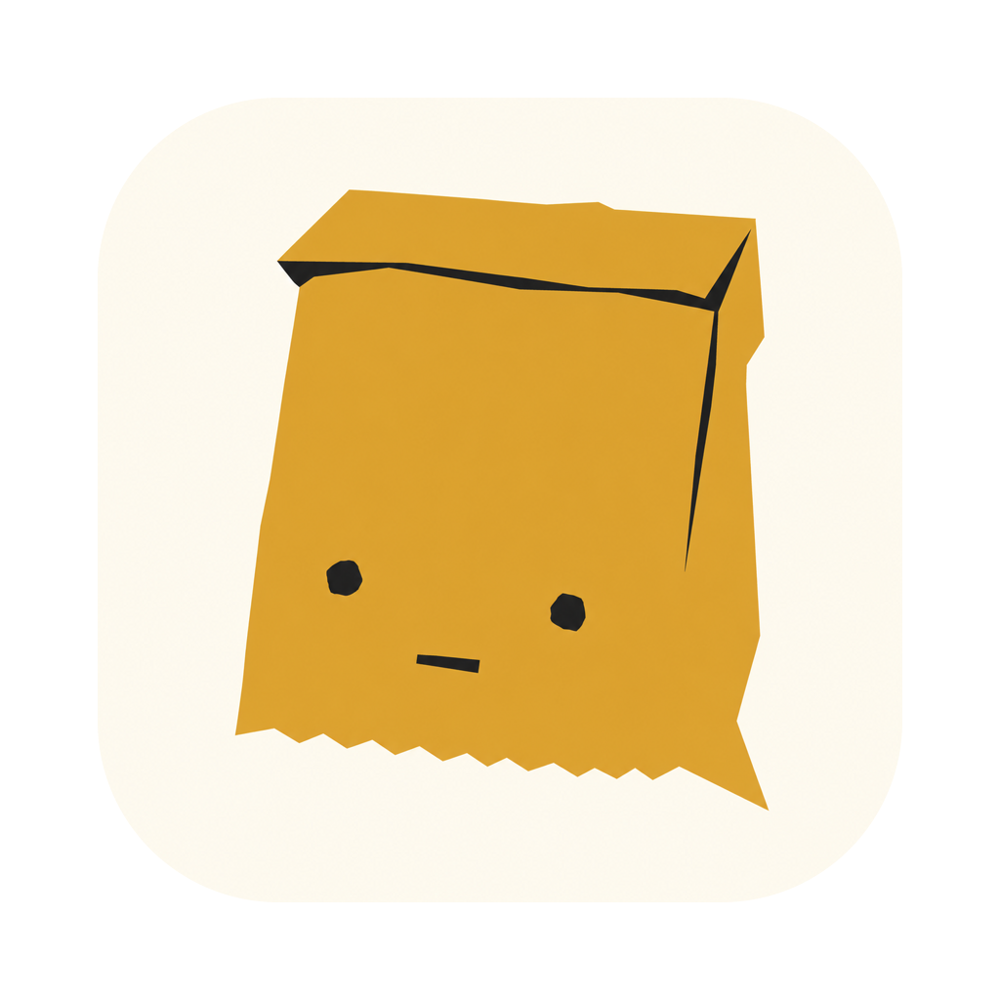
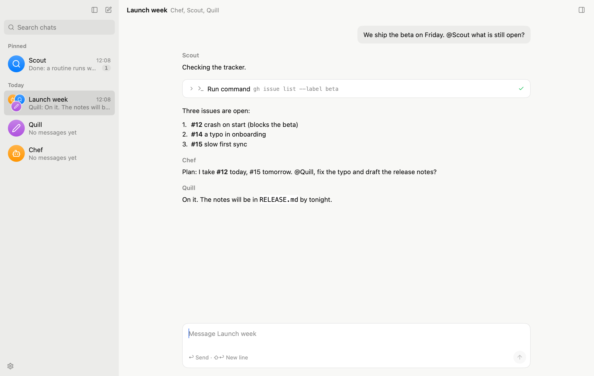

<p align="center"></p>

<h1 align="center">Baggy</h1>

<p align="center">A bag of bots that work together, on your desktop.<br>
<a href="https://zucchinievader.github.io/baggy/">Website</a> · <a href="https://github.com/zucchiniEvader/baggy/releases/latest">Download</a></p>

<p align="center"></p>

Baggy is a desktop assistant for macOS, Windows and Linux. Talk to a bot one to one, or put a few in a group chat where they take turns, hand work to each other and report back. Each bot has its own description, model, memory and working folder; Chef leads and creates teammates when you agree.

- **Group chats**: members reply or pass, mention each other, and hand work on (`message_bot`, `hand_off`).
- **Tools**: files, search, and shell commands in real terminals, with approval or auto-review.
- **Memory**: a `MEMORY.md` and a diary per bot, with compaction that waits for the provider's cache.
- **Routines**: scheduled tasks with checks that only wake the bot when something is new.
- **MCP servers**: their tools from codemode scripts, their resources as tools.
- **Providers**: the Anthropic Messages API and OpenAI's Chat Completions and Responses, so Anthropic, OpenAI, DeepSeek, OpenRouter, Ollama and others.

## Build

Go 1.27 or later; no cgo.

```sh
cd desktop
go tool mygo dev      # run it, rebuilding on changes
go tool mygo build    # build/<platform>/Baggy.app and the installer
go vet ./... && go test ./...   # here and in the repository's root
```

The agent core is in the root module (`agent`, `provider`, `tool`, `team`, `store`, …), the app in `desktop/`, written with [MyGo](https://github.com/egoist/mygo)'s native UI. `docs/` has one document per subject; [AGENTS.md](AGENTS.md) is the map.

## Releases

Pushing a tag `v<version>` builds every platform on GitHub Actions and uploads the installers and signed updates to a draft release; see [docs/release.md](docs/release.md).
